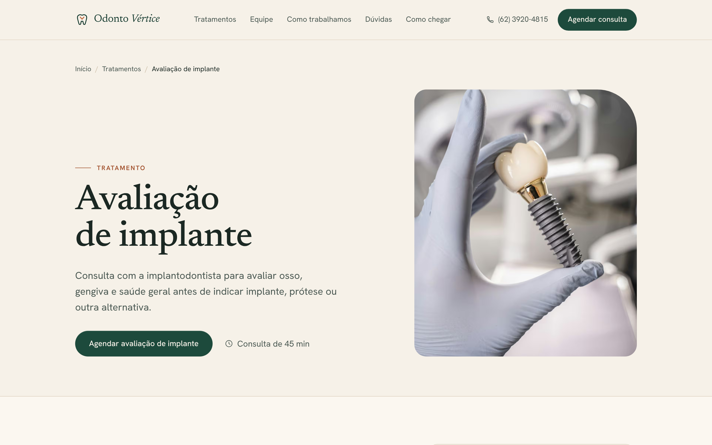
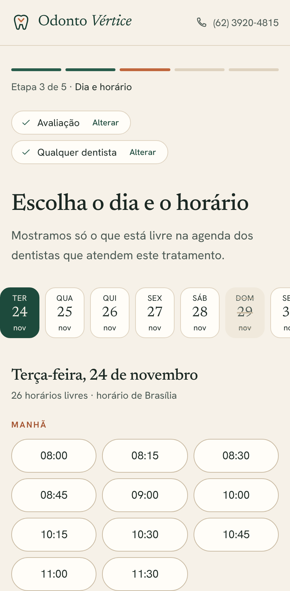
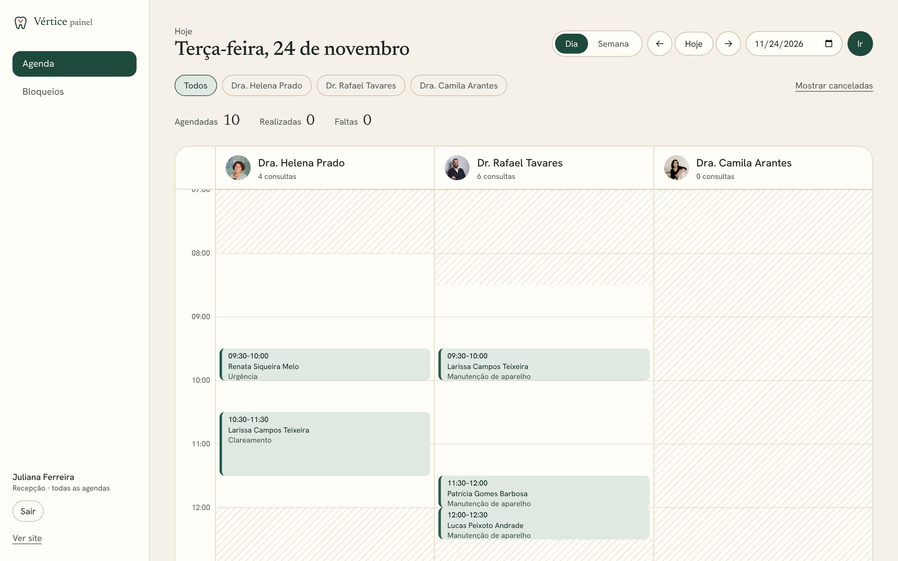
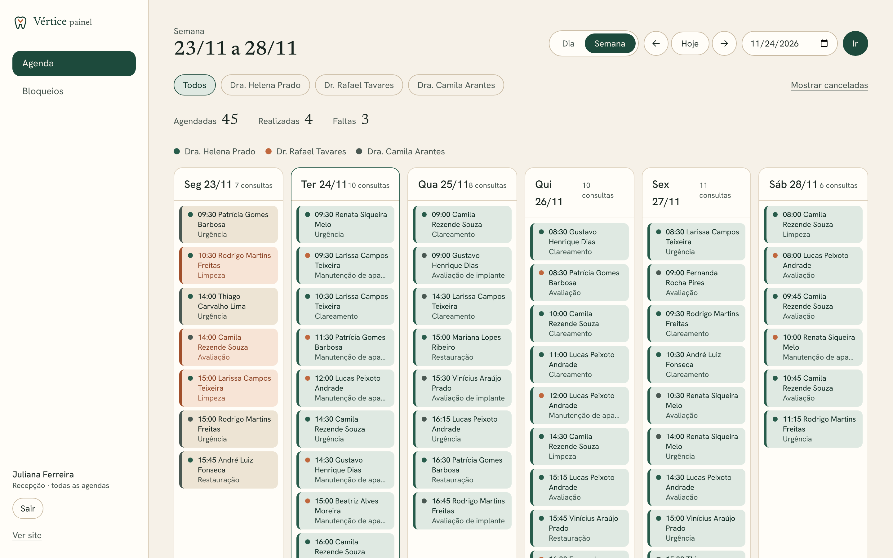
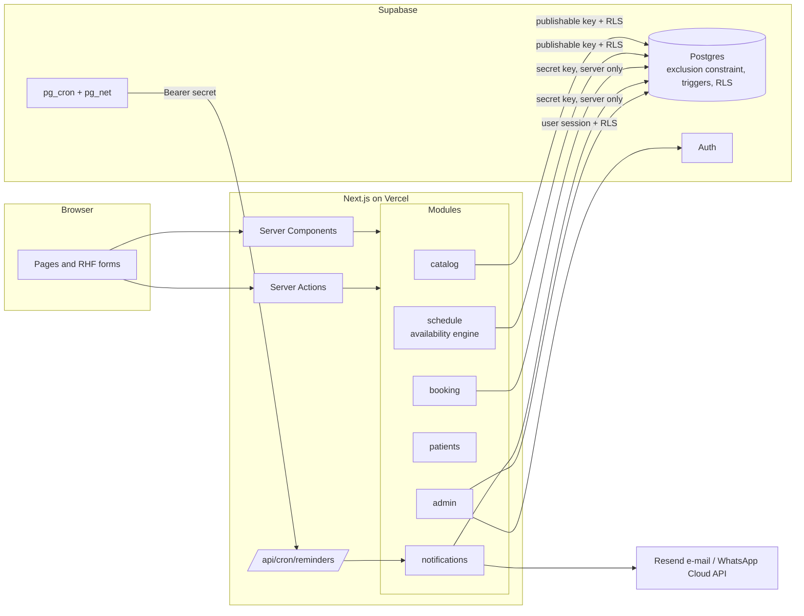

# Odonto Vértice

> **Resumo em português** — Site e sistema de agendamento de uma clínica odontológica fictícia
> no Setor Bueno, em Goiânia. O paciente escolhe tratamento, dentista (ou "qualquer disponível"),
> dia e horário, e recebe por e-mail um link único para remarcar ou cancelar sem login. Os
> horários livres são calculados no servidor a partir da agenda de cada dentista, da duração do
> tratamento, do almoço, de feriados e de bloqueios. O agendamento duplo é impossível no próprio
> Postgres, por uma _exclusion constraint_ com `tstzrange` e `btree_gist`. A clínica tem um painel
> com login (recepção vê todas as agendas, dentista só a sua, garantido por Row Level Security) e
> um lembrete automático na véspera por e-mail, pronto para trocar por WhatsApp. Feito com
> Next.js 16, TypeScript, Tailwind, Supabase, Zod, React Hook Form, Motion, Vitest e Playwright.

<p align="center">
  
</p>

| Home (desktop)                                       | Home (mobile)                                                                   |
| ---------------------------------------------------- | ------------------------------------------------------------------------------- |
|  |  |

| Treatment page                                      | Free slots (mobile)                                                                        |
| --------------------------------------------------- | ------------------------------------------------------------------------------------------ |
|  |  |

| Clinic panel: day                                 | Clinic panel: week                                  |
| ------------------------------------------------- | --------------------------------------------------- |
|  |  |

> Odonto Vértice is a fictional clinic built as a portfolio project. Names, CRO numbers, address,
> phone numbers and testimonials are illustrative; the site says so in its footer.

## Contents

- [What it does](#what-it-does)
- [Stack](#stack)
- [Architecture](#architecture)
- [Double booking protection](#double-booking-protection)
- [Availability engine](#availability-engine)
- [Security](#security)
- [Reminders and notification channels](#reminders-and-notification-channels)
- [Performance, accessibility and SEO](#performance-accessibility-and-seo)
- [Tests](#tests)
- [Running locally](#running-locally)
- [Deployment](#deployment)
- [Photo credits](#photo-credits)

## What it does

**Public site** — home with a live "next free evaluation" card streamed from the database,
editorial treatment list, team, how the clinic works, testimonials, FAQ, an OpenStreetMap-based
location section and a booking CTA that stays visible on phones. Every treatment and dentist has
its own page generated from the database. No prices or promotions anywhere, as required for
Brazilian dental advertising, and the footer shows the technical lead with her CRO-GO number.

**Booking** — `/agendar` → `/agendar/[treatment]` → `/agendar/[treatment]/[dentist]` →
`/agendar/[treatment]/[dentist]/dados`. Each step is a URL, so the back button and shared links
work. Steps one and two are fully static; the slot board and patient form stream behind a static
shell. "Any dentist" merges every dentist's free slots and the server picks the least busy one
when confirming. If someone takes the slot first, the patient gets the next free times instead of
an error. The confirmation links to `/agendamento/[token]`, where the patient can add the
appointment to their calendar (`.ics`), reschedule or cancel without logging in.

**Clinic panel** — `/painel` with Supabase Auth. Reception sees every dentist side by side (day)
or by day (week), filters by dentist, opens an appointment to call or message the patient,
reschedules, cancels (optionally notifying the patient) and records attendance. Dentists see only
their own agenda. Schedule blocks (courses, congresses, equipment maintenance) remove slots from
online booking immediately and refuse to overlap booked appointments.

**Reminders** — every day at 18:00 (Brasília) Supabase Cron calls the app, which claims and sends
tomorrow's reminders exactly once each.

## Stack

| Concern       | Choice                                                                                                                 |
| ------------- | ---------------------------------------------------------------------------------------------------------------------- |
| Framework     | Next.js 16.4 (App Router, React Server Components, Server Actions, Cache Components, Partial Prerendering), React 19.3 |
| Language      | TypeScript 5.9 in strict mode (`noUncheckedIndexedAccess`, `noImplicitOverride`, …)                                    |
| Styling       | Tailwind CSS 4 with a custom token set, no component library                                                           |
| Data          | Supabase: Postgres 17, Auth, Row Level Security, pg_cron, pg_net, Vault                                                |
| Validation    | Zod 4, shared by forms and server, always re-run on the server                                                         |
| Forms         | React Hook Form 7 with `@hookform/resolvers`                                                                           |
| Motion        | Motion 14 (`LazyMotion` with lazily loaded features, `prefers-reduced-motion` respected)                               |
| Tests         | Vitest 5 (unit and database), Playwright 1.63 (end-to-end), axe-core (WCAG)                                            |
| CI / delivery | GitHub Actions, Vercel                                                                                                 |

## Architecture



Code is organized by domain under `src/modules`:

| Module          | Responsibility                                                                      |
| --------------- | ----------------------------------------------------------------------------------- |
| `catalog`       | Treatments, dentists, clinic data and JSON-LD, cached with `use cache` + `cacheTag` |
| `schedule`      | Clinic time helpers, the pure availability engine, opening hours                    |
| `booking`       | Booking, reschedule and cancel use cases, manage tokens, routes, `.ics`             |
| `patients`      | Name, e-mail and Brazilian phone validation and formatting                          |
| `admin`         | Staff session (data access layer), agenda queries, panel schemas                    |
| `notifications` | Channel interface, templates, confirmation notifier and reminder dispatch           |

Decisions worth calling out:

- **The browser never talks to Supabase.** All reads and writes go through Server Components and
  Server Actions, so there is no public client key to abuse and no business rule in the bundle.
- **Three database clients, three trust levels.** Public catalog reads use the publishable key
  (RLS allows only the catalog and a narrow `get_busy_periods` function). Booking, which must run
  for anonymous patients, uses the secret key inside `server-only` modules after Zod validation and
  an availability re-check. The panel uses the signed-in user's session, so **RLS decides what each
  staff member can read and write** — the TypeScript role checks are a second layer, not the only one.
- **One source of truth per rule.** Slot generation lives in a pure TypeScript function that is
  unit-tested in isolation. The database re-checks the invariants that must never break
  (hours, lunch, holidays, blocks, duration, no overlap) in a trigger and a constraint.
- **Static where possible, streamed where needed.** With Cache Components the catalog, treatment
  and dentist pages are prerendered; request-time data (free slots, the next free evaluation, the
  panel) streams behind `<Suspense>` with skeletons that keep the layout stable.

## Double booking protection

Two patients can open the same free slot and press "Confirmar" in the same millisecond. The
application checks availability first, but a check followed by an insert is a race. The guarantee
therefore lives in Postgres:

```sql
create extension if not exists btree_gist;

alter table appointments add constraint appointments_no_overlap
  exclude using gist (dentist_id with =, period with &&)
  where (status <> 'cancelled');
```

- `period` is a half-open `tstzrange` (`[start, end)`), so back-to-back appointments are allowed and
  any overlap, partial or total, is rejected.
- `btree_gist` lets the GiST index compare the `uuid` with `=` while the range uses `&&`.
- The partial predicate frees a slot as soon as an appointment is cancelled.
- When two transactions insert overlapping rows, the second **waits for the first to commit** and
  then fails with SQLSTATE `23P01`. There is no window in which both can succeed, whatever the
  isolation level, number of servers or retries.

The booking function computes the end of the period from the treatment duration in SQL, so the
client cannot stretch an appointment. A `BEFORE INSERT OR UPDATE` trigger rejects periods outside
the dentist's hours, across lunch, on holidays, over manual blocks or in the past.

On `23P01`, `bookAppointment` tries the next candidate when the patient chose "any dentist"; when
there is none left, the action returns the next free slots and the form offers them in place.

This is proven at two levels:

- `tests/db/double-booking.test.ts` fires 12 concurrent `book_appointment` calls for one slot and
  asserts exactly one row exists; another test interleaves two explicit transactions to show the
  second one blocks and then fails. Dropping the constraint makes these tests fail.
- `tests/e2e/double-booking.spec.ts` opens two browsers on the same slot, confirms both at once and
  asserts one confirmation and one guided conflict, then completes the second booking with a
  suggested alternative.

## Availability engine

`src/modules/schedule/domain/availability.ts` is a pure function: weekly schedules (with lunch),
treatment duration, holidays, busy periods (appointments and blocks), "now" and a policy (15-minute
grid, 2-hour minimum notice, 45-day horizon) go in; free slots with the dentists available at each
start come out. All arithmetic happens on absolute instants and wall-clock times are converted
with the `America/Sao_Paulo` zone, so a slot is never off by an hour around midnight UTC or a
daylight saving change (there is a test with `America/New_York` to prove it). Edge cases covered by
unit tests include slots ending exactly at lunch, treatments longer than any window, blocks
spanning several days, the minimum-notice boundary, the last day of the horizon and merging
dentists with different schedules.

## Security

- **Row Level Security** on every table. Anonymous visitors can read the catalog only; staff read
  and update appointments, patients and blocks for the dentists they can access (reception: all;
  dentist: their own). Column grants limit staff updates to `period`, `status` and
  `cancellation_reason`. `tests/db/row-level-security.test.ts` exercises each rule as `anon`, a
  dentist and reception.
- **Manage links** are `HMAC-SHA256(MANAGE_TOKEN_SECRET, appointment_id)`, 256 bits, base64url.
  The database stores only their SHA-256 hash, the server can recompute the link for reminders, and
  the pages send `Referrer-Policy: no-referrer` and `noindex`.
- **Validation**: every Server Action and route parses its input with Zod. Path and query
  parameters are slug- or ISO-checked; malformed values fall back or show a non-indexable 404.
- **Abuse**: a per-client booking rate limit in Postgres (HMAC of the IP, 10 attempts per 15
  minutes by default), a honeypot field, and Supabase Auth's own sign-in limits.
- **Headers**: CSP with `frame-ancestors 'none'`, `object-src 'none'`, `base-uri` and `form-action`
  restricted, `X-Content-Type-Options`, `Referrer-Policy` and `Permissions-Policy`.
- **Cron endpoint** accepts only `Authorization: Bearer $CRON_SECRET`, compared in constant time.
- **LGPD**: explicit consent checkbox; patient data is visible only to the staff who need it.

## Reminders and notification channels

```
pg_cron (21:00 UTC = 18:00 BRT)
  └─ private.dispatch_reminders()        reads app_url and cron_secret from Supabase Vault
       └─ net.http_post → /api/cron/reminders
            └─ claim_reminders(tomorrow)  inserts one notification_deliveries row per
                                          (appointment, kind, start) — a unique key
            └─ channel.send(notice)       e-mail, WhatsApp or console
            └─ record receipt             sent / failed (retried up to 3 times)
```

Claims are idempotent, so the job can run twice (for example Supabase Cron and the fallback Vercel
Cron in `vercel.json`) without sending anything twice, and a rescheduled appointment gets a fresh
reminder for its new time. Channels implement one interface:

```ts
interface NotificationChannel {
  readonly name: 'console' | 'email' | 'whatsapp'
  send(notice: AppointmentNotice): Promise<DeliveryReceipt>
}
```

`NOTIFICATION_CHANNEL=email` uses Resend; `whatsapp` uses the WhatsApp Cloud API with approved
templates (`consulta_confirmada`, `consulta_lembrete`, `consulta_remarcada`, `consulta_cancelada`).
The WhatsApp channel is covered by unit tests against the API contract but has not been exercised
against a live number.

## Performance, accessibility and SEO

Lighthouse 13.6, mobile preset (Moto G Power emulation, simulated slow 4G), production build behind
a local HTTP/2 proxy. Median of three runs:

| Page                            | Performance | Accessibility | Best practices | SEO |
| ------------------------------- | :---------: | :-----------: | :------------: | :-: |
| `/`                             |     95      |      100      |      100       | 100 |
| `/tratamentos/limpeza`          |     96      |      100      |      100       | 100 |
| `/equipe/helena-prado`          |     98      |      100      |      100       | 100 |
| `/agendar`                      |     99      |      100      |      100       | 100 |
| `/agendar/limpeza/helena-prado` |     98      |      100      |      100       | 100 |

What moved the needle: Motion's animation features load lazily (150 KB → 34 KB on the critical
path), Newsreader without the optical-size axis and a lazily loaded italic (307 KB → 115 KB of
fonts), LCP images with `fetchPriority="high"`, AVIF at quality 60 and portraits cropped to the
displayed ratio, inline CSS, and static HTML for treatment and dentist pages. CLS is 0 on most pages.

Accessibility goes beyond the score: axe-core runs in the E2E suite against WCAG 2.1 AA on public
pages, booking steps and the panel login; focus is always visible; every field has a label, hint
and error wired through `aria-describedby`; the stepper uses `aria-current="step"`; and a skip link
is the first focusable element.

Local SEO: per-page metadata and canonical URLs, generated Open Graph image, `sitemap.xml`,
`robots.txt`, and JSON-LD for `Dentist` (address, geo, opening hours derived from the dentists'
schedules, telephone, staff), `Person`, `MedicalProcedure`, `FAQPage` and `BreadcrumbList`.

## Tests

| Suite           | Command         | What it covers                                                                                                                                 |
| --------------- | --------------- | ---------------------------------------------------------------------------------------------------------------------------------------------- |
| Unit (112)      | `pnpm test`     | Availability engine, clinic time, schemas, phone rules, tokens, `.ics`, templates, channels, agenda helpers, JSON-LD                           |
| Database (37)   | `pnpm test:db`  | Exclusion constraint under concurrency, slot-rule trigger, RLS per role, role privileges, rate limit, reminder claims                          |
| End-to-end (25) | `pnpm test:e2e` | Full booking → reschedule → cancel, validation, double booking with two browsers, panel roles and blocks, SEO, no sideways scroll, axe WCAG AA |

Unit coverage on domain logic: 98% lines, 87% branches (enforced thresholds in CI).

## Running locally

Requirements: Node 22, pnpm 10 and Docker.

```bash
pnpm install
```

```bash
pnpm db:start
```

```bash
pnpm db:env
```

```bash
pnpm dev
```

`db:start` runs Supabase locally (Postgres, Auth, REST) and applies the migrations and seed;
`db:env` writes `.env.local` from the local stack. Open http://localhost:3000.

Demo panel accounts (password `vertice-demo-2026`):

| Role      | E-mail                           |
| --------- | -------------------------------- |
| Reception | `recepcao@odontovertice.example` |
| Dentist   | `helena@odontovertice.example`   |
| Dentist   | `rafael@odontovertice.example`   |
| Dentist   | `camila@odontovertice.example`   |

The seed generates appointments from two weeks ago to three weeks ahead relative to the day you
run it, so the panel is never empty. `pnpm db:reset` regenerates everything. Confirmation and
reminder messages print to the terminal while `NOTIFICATION_CHANNEL=console`.

Other scripts: `pnpm lint`, `pnpm typecheck`, `pnpm format`, `pnpm test:coverage`,
`pnpm db:types` (regenerates `database.types.ts`) and `node scripts/capture-media.mjs` (regenerates
the screenshots and GIF against a running build on port 3100).

## Deployment

1. **Supabase**: create a project, then link and push the schema.

   ```bash
   pnpm exec supabase link --project-ref <project-ref>
   ```

   ```bash
   pnpm exec supabase db push
   ```

   For the demo data, run `supabase/seed.sql` in the SQL editor. Then store the cron settings in
   Vault so Supabase Cron can reach the app:

   ```sql
   select vault.create_secret('https://<your-domain>', 'app_url');
   select vault.create_secret('<same value as CRON_SECRET>', 'cron_secret');
   ```

2. **Vercel**: import the repository and set the variables from `.env.example`
   (`NEXT_PUBLIC_SITE_URL`, `SUPABASE_URL`, `SUPABASE_PUBLISHABLE_KEY`, `SUPABASE_SECRET_KEY`,
   `MANAGE_TOKEN_SECRET`, `CRON_SECRET`, `NOTIFICATION_CHANNEL` and the e-mail or WhatsApp keys).

3. **GitHub Actions** deploys `main` after the quality and integration jobs pass. Add the
   repository secrets `VERCEL_TOKEN`, `VERCEL_ORG_ID`, `VERCEL_PROJECT_ID` and `SUPABASE_DB_URL`.

## Photo credits

All photos are from [Unsplash](https://unsplash.com) under the
[Unsplash License](https://unsplash.com/license) (free for commercial use). The people pictured are
models with no relation to this fictional clinic. Credits also appear on the site at `/creditos`.

| Use                            | Photographer                  | Photo                                                                                                                              |
| ------------------------------ | ----------------------------- | ---------------------------------------------------------------------------------------------------------------------------------- |
| Home hero                      | Lesly Juarez                  | [unsplash.com/photos/1AhGNGKuhR0](https://unsplash.com/photos/long-black-haired-woman-smiling-close-up-photography-1AhGNGKuhR0)    |
| Consultation, evaluation       | Caroline LM                   | [unsplash.com/photos/-m-4tYmtLlI](https://unsplash.com/photos/man-in-white-dress-shirt-holding-black-pen--m-4tYmtLlI)              |
| Cleaning                       | Caroline LM                   | [unsplash.com/photos/8BkF0sTC6Uo](https://unsplash.com/photos/dental-exam-with-mirror-and-tool-8BkF0sTC6Uo)                        |
| Restoration                    | Caroline LM                   | [unsplash.com/photos/ux18C551ghI](https://unsplash.com/photos/dental-mirror-and-explorer-tool-ux18C551ghI)                         |
| Whitening                      | Nolan Manning                 | [unsplash.com/photos/Ll9YOG20UFI](https://unsplash.com/photos/smiling-woman-at-wooden-table-Ll9YOG20UFI)                           |
| Braces maintenance             | Atikah Akhtar                 | [unsplash.com/photos/hKaYlAF1nDw](https://unsplash.com/photos/person-with-silver-teeth-braces-hKaYlAF1nDw)                         |
| Implant evaluation             | Katarzyna Zygnerska           | [unsplash.com/photos/eHwRLpfHSKY](https://unsplash.com/photos/gloved-hand-holding-a-dental-implant-and-crown-eHwRLpfHSKY)          |
| Urgent care                    | D Dental Office               | [unsplash.com/photos/BiknMFl7iOw](https://unsplash.com/photos/dentist-examining-teeth-in-dental-office-BiknMFl7iOw)                |
| Clinic room                    | Benyamin Bohlouli             | [unsplash.com/photos/e7MJLM5VGjY](https://unsplash.com/photos/modern-dental-office-with-chair-and-equipment-e7MJLM5VGjY)           |
| Reception                      | Caroline Badran               | [unsplash.com/photos/jH05wxjmAWE](https://unsplash.com/photos/woman-sitting-in-a-modern-waiting-room-reading-jH05wxjmAWE)          |
| Dra. Helena Prado (portrait)   | Christina @ wocintechchat.com | [unsplash.com/photos/SJvDxw0azqw](https://unsplash.com/photos/woman-on-focus-photography-SJvDxw0azqw)                              |
| Dr. Rafael Tavares (portrait)  | Willian Souza                 | [unsplash.com/photos/p5BoBF0XJUA](https://unsplash.com/photos/man-in-black-zip-up-jacket-p5BoBF0XJUA)                              |
| Dra. Camila Arantes (portrait) | Jonathan Borba                | [unsplash.com/photos/n1B6ftPB5Eg](https://unsplash.com/photos/woman-in-black-long-sleeve-shirt-sitting-on-white-couch-n1B6ftPB5Eg) |

Map tiles © [OpenStreetMap](https://www.openstreetmap.org/copyright) contributors. Fonts:
Newsreader and Hanken Grotesk (SIL Open Font License).
